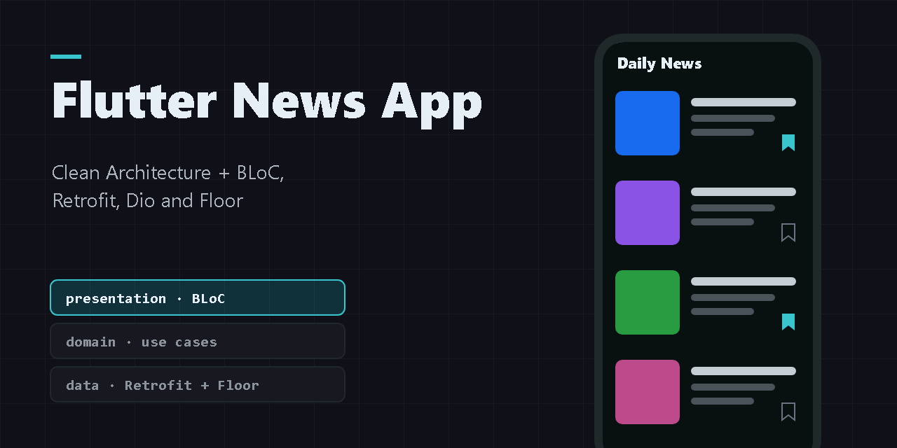

# Flutter News App with Clean Architecture and BLoC


**A Flutter news app that shows live headlines from [NewsAPI](https://newsapi.org) and saves articles for offline reading, built with Clean Architecture, the BLoC pattern, Retrofit + Dio and Floor (SQLite).**

Use it as a reference project for structuring a real Flutter app into data, domain and presentation layers, with dependency injection and separate BLoCs for remote and local data.

## Features

- **Top headlines from two feeds:** technology news for India and general news for the US, from the NewsAPI `top-headlines` endpoint.
- **Article details:** open any story to read its full summary and image.
- **Save for later:** bookmark articles into a local SQLite database with Floor and read them offline.
- **Bottom navigation** between the news feeds and saved articles.
- **Animated splash screen** with Lottie.
- **Cached network images** so scrolling stays smooth and images don't reload.

## Tech stack

| Concern | Package |
| --- | --- |
| State management | [flutter_bloc](https://pub.dev/packages/flutter_bloc), [equatable](https://pub.dev/packages/equatable) |
| Networking | [dio](https://pub.dev/packages/dio), [retrofit](https://pub.dev/packages/retrofit) |
| Local database | [floor](https://pub.dev/packages/floor) (SQLite) |
| Dependency injection | [get_it](https://pub.dev/packages/get_it) |
| JSON | [json_annotation](https://pub.dev/packages/json_annotation), [json_serializable](https://pub.dev/packages/json_serializable) |
| UI | [flutter_hooks](https://pub.dev/packages/flutter_hooks), [cached_network_image](https://pub.dev/packages/cached_network_image), [lottie](https://pub.dev/packages/lottie), [ionicons](https://pub.dev/packages/ionicons) |
| Code generation | [build_runner](https://pub.dev/packages/build_runner), retrofit_generator, floor_generator |

## Architecture

The app follows Clean Architecture, with one feature module, `daily_news`:

```text
lib/
├── config/                     # routes and app theme
├── core/                       # constants, DataState wrapper, base UseCase
└── features/daily_news/
    ├── data/                   # Retrofit API services, Floor DAO and database, models, repository implementations
    ├── domain/                 # entities, repository contracts, use cases
    └── presentation/           # BLoCs (remote and local articles), pages and widgets
```

- **Data layer:** Retrofit services call NewsAPI through Dio; a Floor DAO stores saved articles in SQLite.
- **Domain layer:** plain Dart entities and use cases, with no Flutter or package imports.
- **Presentation layer:** `RemoteArticlesBloc` loads headlines and `LocalArticleBloc` saves, lists and removes bookmarks.

## Getting started

### Prerequisites

- Flutter SDK (Dart `>=2.17.0 <3.0.0`, as set in `pubspec.yaml`)
- A free API key from [newsapi.org](https://newsapi.org/register)

### Run it

```bash
git clone https://github.com/Clufy/flutter-news-app-bloc-clean-architecture.git
cd flutter-news-app-bloc-clean-architecture
flutter pub get
dart run build_runner build --delete-conflicting-outputs   # regenerate Retrofit, Floor and JSON code
```

Put your NewsAPI key in `lib/core/constants/constants.dart` (`newsAPIKey`), then:

```bash
flutter run
```

## Author

Built by **[Aquib Haq](https://github.com/Clufy)**, AI and backend engineer. More projects at [clufy.github.io](https://clufy.github.io/).

### More Flutter projects

- [flutter-spotify-ui-clone](https://github.com/Clufy/flutter-spotify-ui-clone): a Spotify UI clone in Flutter.
